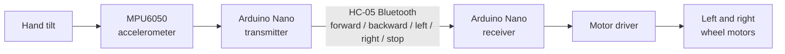

# Gesture-Controlled Wheelchair

**A wheelchair that moves by moving your hand. A sensor on the hand reads its tilt and sends the direction over Bluetooth to the wheelchair, which drives its motors.**

Ahmed Mohamed Elanany

## Demo

▶️ [Watch the wheelchair moving](videos/wheelchair_demo.mp4)

## How it works

1. **Read the hand:** an MPU6050 on the hand measures the tilt.
2. **Decide the direction:** the transmitter Nano turns the tilt into a command:

   | Hand | Command |
   | --- | --- |
   | Tilted forward | `forward` |
   | Tilted back | `backward` |
   | Tilted left | `left` |
   | Tilted right | `right` |
   | Level | `stop` |

3. **Send it:** the command goes over Bluetooth (HC-05) every 0.4 s.
4. **Drive:** the receiver Nano reads the command and drives the two wheel motors through the motor driver. To turn, the wheels spin in opposite directions.

## Hardware

| Part | Qty | Role |
| --- | --- | --- |
| Arduino Nano | 2 | One on the hand (transmitter), one on the wheelchair (receiver) |
| HC-05 Bluetooth module | 2 | Wireless link between the two Nanos |
| MPU6050 | 1 | Accelerometer and gyroscope that reads the hand tilt |
| Dual H-bridge motor driver | 1 | Drives the left and right motors |
| DC motors | 2 | Left and right wheels |

### Pins

**Transmitter:** MPU6050 on I2C (A4 = SDA, A5 = SCL), HC-05 on D4 (RX) and D5 (TX).

**Receiver:** HC-05 on D8 (RX) and D9 (TX). Motor driver: ENA = D3, ENB = D5, IN1 = D2, IN2 = D4, IN3 = D7, IN4 = D6.

## Code

| Folder | What is inside |
| --- | --- |
| [`transmitter/`](transmitter) | Reads the MPU6050 and sends the direction over Bluetooth (needs the I2Cdev and MPU6050 libraries) |
| [`receiver/`](receiver) | Receives the direction and drives the motors |

## Author

**Ahmed Mohamed Elanany** · [LinkedIn](https://www.linkedin.com/in/ahmed-elanany) · ahmedelanany34@gmail.com
